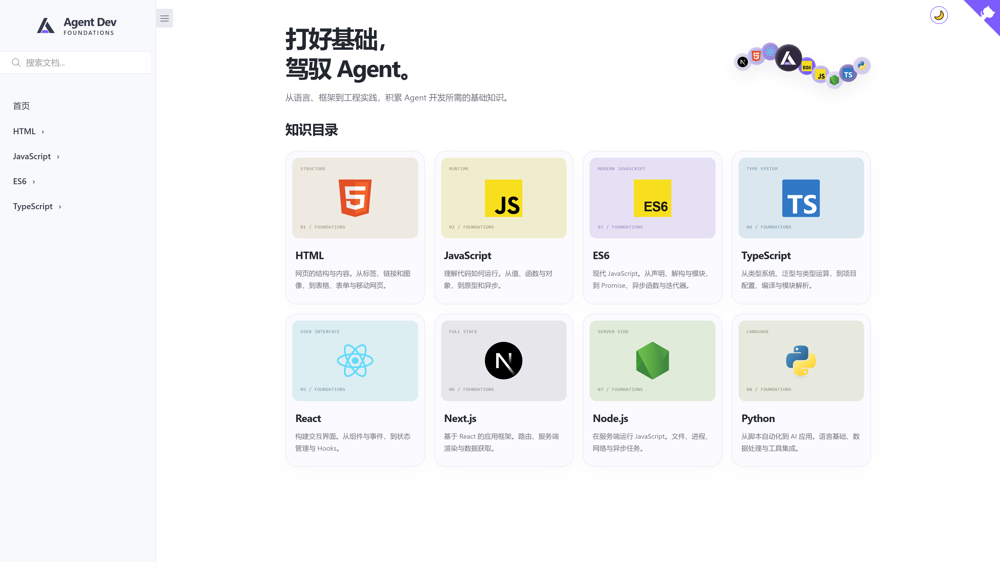
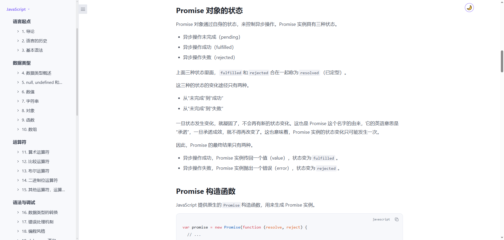
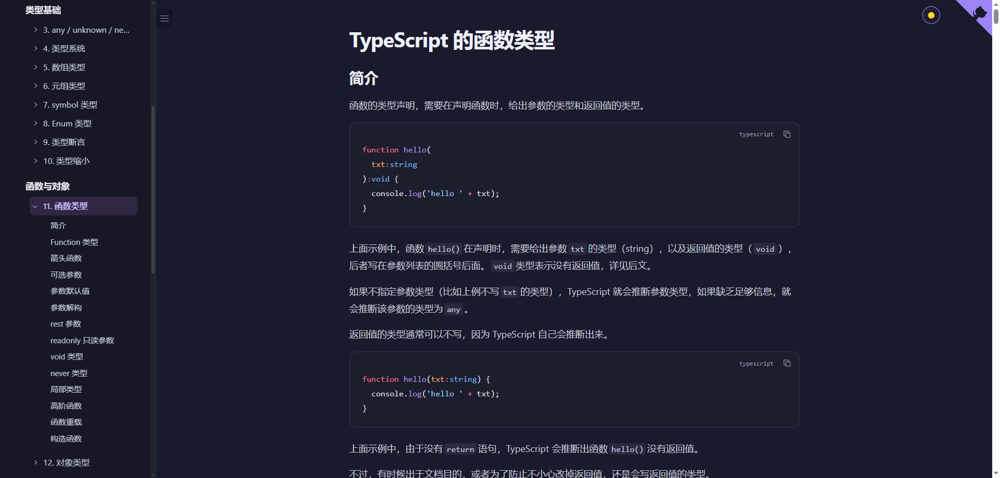
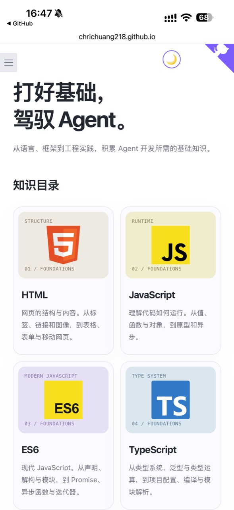
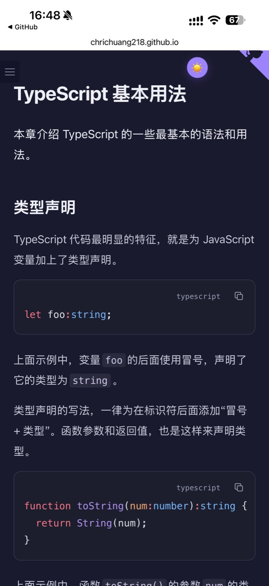
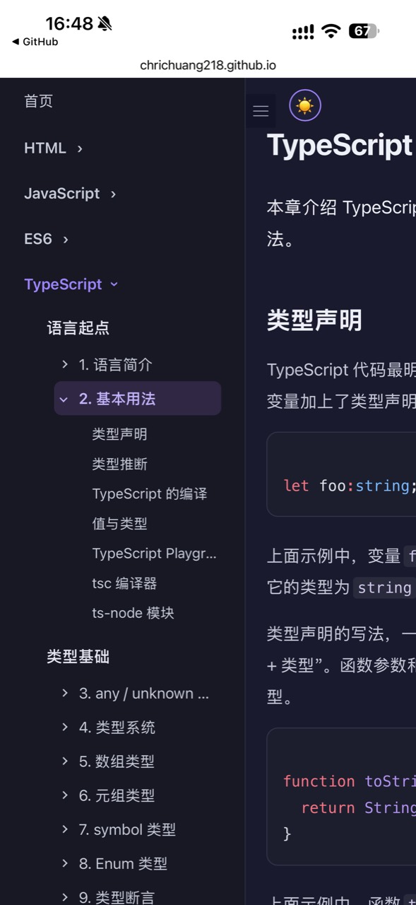

# Agent Dev Foundations

**打好基础，驾驭 Agent。**

[在线阅读](https://chrichuang218.github.io/agent-dev-foundations/) · [更新记录](CHANGELOG.md)

[](LICENSE.md#本站原创程序-mit-license)

面向后端程序员的 Agent 开发基础知识参考站。围绕 HTML、JavaScript、ES6 和 TypeScript，提供完整讲解、代码示例与项目配置参考，方便阅读源码时随时查阅。

支持全文搜索、章节导航、代码复制、浅色与深色模式，以及手机端阅读。

## 界面预览



<details open>
<summary>阅读界面 · 浅色与深色</summary>





</details>

### 手机端

| 首页 | 深色阅读 | 展开目录 |
| --- | --- | --- |
|  |  |  |

## 内容范围

| 分区 | 内容 | 收录 |
| --- | --- | --- |
| HTML | 网页结构、标签、链接、表单 | 17 篇 |
| JavaScript | 语言基础、对象、原型与异步 | 38 篇 |
| ES6 | 现代语法、模块、Promise 与异步函数 | 37 篇 |
| TypeScript | 类型系统、泛型及项目配置 | 33 篇 |
| React | [官方中文文档](https://zh-hans.react.dev/learn) | 外部入口 |
| Next.js | [Next.js 中文文档](https://nextjscn.org/docs)（社区翻译） | 外部入口 |
| Node.js | [Node.js 中文网 · 学习](https://nodejs.cn/learn)（社区翻译） | 外部入口 |
| Python | [官方中文教程](https://docs.python.org/zh-cn/3/tutorial/) | 外部入口 |

本站共收录 **125 篇**，主体来自阮一峰及网道贡献者编写的教程，保留完整正文。TypeScript 分区包含 6 篇项目配置文章。

部分教程保留历史语法和版本背景，具体来源与整理范围见 [来源记录](docs/SOURCES.md) 和 [章节清单](docs/COVERAGE.md)。

## 本地运行

需要 Node.js **22.12 或更高版本**。

```sh
npm ci
npm run dev
```

默认地址为 <http://127.0.0.1:4321/>，以终端输出为准。

构建与预览：

```sh
npm run build
npm run preview
```

本站基于 Astro 构建为静态页面，产物位于 `dist/`。

## 贡献与维护

欢迎通过 Issue 或 PR 提交问题、勘误和改进建议。

- 页面与交互代码位于 `src/`。
- 元数据与注记在 `content/editorial.json` 中维护；原创配置文章位于 `content/local/`。
- 请勿直接修改 `content/upstream/` 中的来源快照。更新上游内容时保留署名、许可与版本记录，详见 [来源与维护说明](docs/SOURCES.md)。

提交前运行：

```sh
npm run verify
```

检查覆盖内容完整性、类型、构建、站内链接、搜索索引和选定示例；不代表执行了全部教程示例。界面修改还需检查桌面及手机布局。详见 [验证记录](docs/VERIFICATION.md)。

GitHub Actions 在 `main` 推送后自动验证并部署 GitHub Pages。仓库子路径构建需设置 `SITE_BASE=/agent-dev-foundations/`。

## License

**本站原创代码采用 [MIT License](LICENSE.md#本站原创程序-mit-license)。**

教程正文和第三方资源保留各自许可：

| 内容 | 许可 |
| --- | --- |
| JavaScript、ES6 教程及整理 | CC BY-SA 3.0 |
| HTML、TypeScript 教程及原创配置文章 | CC BY-SA 4.0 |
| 第三方界面样式、图片与技术标识 | 各自许可及品牌使用要求 |

MIT 不覆盖教程正文或第三方资源。完整许可、署名与使用范围见 [LICENSE.md](LICENSE.md) 和 [licenses/](licenses/)。

## 致谢

🙏 感谢 [LINUX DO](https://linux.do/) 社区的支持与讨论。

感谢 [网道（WangDoc）](https://github.com/wangdoc)、阮一峰及贡献者提供 HTML、JavaScript、ES6 和 TypeScript 教程。

感谢 [React 团队及中文翻译贡献者](https://zh-hans.react.dev/)，提供清晰、完整的 React 官方中文文档。
